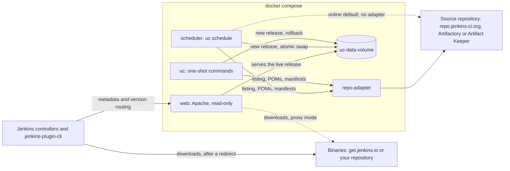

# Easy Update Center for Jenkins

[](https://github.com/HaleTechCo/easy-update-center/actions/workflows/ci.yml)

**The upstream Jenkins update-center2, containerized and extended, with support for Artifact Keeper
and air-gapped networks.**

The same update center Jenkins uses (`updates.jenkins.io`), in containers on your own host. Jenkins
controllers and `jenkins-plugin-cli` point at it with no plugin or code change. It reads plugins
from the public plugin repository or from your own, and runs online or fully air-gapped.

## What you get

### From upstream

[update-center2](https://github.com/jenkins-infra/update-center2) is the generator the Jenkins
project runs to build updates.jenkins.io. This repository builds it from a pinned release, so you
get what Jenkins controllers already expect:

- **Every upstream file:** `update-center.json`, `plugin-versions.json`, `release-history.json`,
  the experimental and stable sites, download index pages, and tool installers.
- **Version routing:** `/update-center.json?version=2.528.1` redirects each controller to the tiered
  site that only offers plugins its core can run, exactly as updates.jenkins.io does.

### What this repository adds

On its own, update-center2 is a Java program that reads repo.jenkins-ci.org's Artifactory and
writes files. Around it, this repository adds:

- **Containers and a scheduler:** a uc image (the generator and the `uc` command) and an Apache web
  image, run with Docker Compose. The scheduler regenerates the site on your schedule, and Apache
  serves it, sending downloads to get.jenkins.io or to your repository.
- **Artifact Keeper, and your own Artifactory:** update-center2 only speaks Artifactory's API and
  expects repo.jenkins-ci.org's layout. The [repo-adapter](docs/architecture/repo-adapter.md)
  answers its requests from Artifactory or Artifact Keeper, and fills in the POMs, descriptions and
  release dates a private repository lacks from the plugins themselves.
- **Air-gapped mode:** the whole stack runs with no internet access, from your own repository; see
  [Online or air-gapped](#online-or-air-gapped).
- **Two small generator patches:** popularity data becomes optional (upstream fails without it,
  which rules out air-gapped runs), and the 400-day core age for tiers becomes a setting.
  [The patches](docs/development/upgrading-upstream.md#the-patches) are meant to go upstream.
- **Your own signing keys:** `uc pki` creates and rotates the PKI that signs the metadata;
  controllers trust your root CA.
- **Safe publishing:** each release is validated before it goes live, the switch is atomic, the last
  five releases are kept, and `uc rollback` goes back in one command.
- **Procurement help:** `uc procure` stages the real POMs, missing dependencies and cores your
  repository lacks for review, records files you add by hand (moving misplaced ones), pushes exactly
  what you approved, and cleans up what the repository then holds.
- **Your own policy:** hide plugins or releases, and publish your own security warnings.
- **Monitoring:** `status.json` reports the last run, the certificate's expiry and the age of the
  security data.
- **Settings in one file:** every setting in `.env`; `uc config` shows
  each value and where it came from, and the scheduler can run a read-only `uc doctor` report on its
  own schedule.

### Online or air-gapped

`MODE` in `.env` picks one of two sets of defaults. Online, the update center behaves like
updates.jenkins.io and fetches upstream data live; air-gapped, it never reaches the internet and
works from your own repository.

| | Online | Air-gapped |
|---|---|---|
| Plugins and cores come from | repo.jenkins-ci.org (needs a free Jenkins community account), or your own Artifactory or Artifact Keeper | Your Artifactory or Artifact Keeper, read through the repo-adapter |
| Controllers download from | get.jenkins.io, or your repository | Your repository, directly or through the web container |
| Security warnings and suspensions | Fetched from upstream at every run | The copy bundled in the image, or one you procure; `status.json` shows its age |
| Popularity and tool installers | Fetched from upstream at every run | Only from copies you procure; otherwise popularity is 0 and tool installers are left out |
| Labels from GitHub, issue trackers, maintainers | Fetched from upstream (a GitHub token is recommended for labels) | Dropped with a warning |
| Cores offered as tiers | Those released in the last 400 days, as on updates.jenkins.io | Every core your repository holds that a plugin requires, however old |
| Internet at run time | Needed | None; upstream hosts are refused at once rather than timing out |

Both modes produce the same files, version routing and signatures, and apply your own warnings and
blocklist. `MODE` only chooses defaults: online mode can read your own repository and still fetch
upstream data live, and every setting can be changed in either mode. More in
[Modes](docs/architecture/modes.md).

## How it works

A scheduler regenerates the site with Jenkins' own generator, update-center2, and an Apache
container serves it. Plugin binaries are not copied: downloads go to get.jenkins.io or to your
repository. More in the [architecture overview](docs/architecture/overview.md).



## Quick start

You need a Linux host with Docker (Compose v2) and git, a hostname for the update center, and a
Jenkins community account (online) or an account on your repository (air-gapped). Details:
[Requirements](docs/getting-started/requirements.md).

### Online

Take the latest version from the
[Releases page](https://github.com/HaleTechCo/easy-update-center/releases):

```bash
git clone --branch v<version> https://github.com/HaleTechCo/easy-update-center.git
cd easy-update-center
cp .env.online.example .env
# in .env: set PUBLIC_URL to your update center's origin, and
#   UC_IMAGE=ghcr.io/haletechco/easy-update-center-uc:<version>
#   WEB_IMAGE=ghcr.io/haletechco/easy-update-center-web:<version>
docker compose pull                  # fails loudly if the images cannot be pulled
docker compose run --rm --no-deps uc --version      # must print uc <version>
docker compose run --rm setup        # credential placeholders, ./procurement, signing keys
printf '%s' 'community-user' > secrets/repo_username        # free: https://accounts.jenkins.io
printf '%s' 'community-password' > secrets/repo_password
docker compose up -d
```

To build from source instead, clone `main`, leave `UC_IMAGE` and `WEB_IMAGE` unset and run
`docker compose build` (or `make build`) before `setup`. With GNU make, `make setup` is a shortcut
for the setup step; `make help` lists the targets you run. To check a release's signatures before
you run it: [Verify a release](docs/how-to/verify-a-release.md).

`secrets/` stays yours, with no `sudo`: `setup` lets each container read its own files through its
group ([File ownership on Linux](docs/reference/secrets.md#file-ownership-on-linux)). Move
`secrets/root/`, which holds the root CA's key, offline afterwards
([After the quick start](#after-the-quick-start)).

The first run reads the whole plugin catalog and **takes hours**; follow it with
`docker compose logs -f scheduler`. When `docker compose run --rm uc status` shows a `live_release`,
point Jenkins at it: [Configure Jenkins controllers](docs/how-to/configure-jenkins.md).

Full walkthrough: [Deploy online](docs/getting-started/online.md).

### Air-gapped

On a machine with internet access, download the release's air-gapped bundle for the Docker host's
architecture (`easy-update-center-<version>-airgapped-amd64.tar` or `-arm64.tar`) with `SHA256SUMS`
and `SHA256SUMS.sigstore.json` from the
[Releases page](https://github.com/HaleTechCo/easy-update-center/releases), and
[verify them](docs/how-to/verify-a-release.md#the-air-gapped-bundle-and-other-assets). On the Docker
host:

```bash
tar -xf easy-update-center-<version>-airgapped-amd64.tar     # or -arm64
cd easy-update-center-<version>-airgapped-amd64
docker load -i images.tar
tar -xzf easy-update-center-<version>.tar.gz
cd easy-update-center-<version>
cp .env.airgapped.example .env
# in .env: set PUBLIC_URL, REPO_URL, REPO_KEY; uncomment COMPOSE_FILE; and set
#   UC_IMAGE=ghcr.io/haletechco/easy-update-center-uc:<version>
#   WEB_IMAGE=ghcr.io/haletechco/easy-update-center-web:<version>
docker compose run --rm setup         # credential placeholders, ./procurement, signing keys
printf '%s' 'svc-easy-update-center' > secrets/repo_username
printf '%s' 'password-or-token' > secrets/repo_password
docker compose run --rm uc doctor --fetch       # what the generator will see in your repository
docker compose up -d
```

To build from source instead, leave `UC_IMAGE` and `WEB_IMAGE` unset and run `docker compose build`
(or `make build`) on a machine with internet access; to carry a source build across, see
[Or build from source](docs/getting-started/airgapped.md#or-build-from-source). With GNU make,
`make setup` is a shortcut for the setup step.

Your repository holds the plugins and cores to offer, in Maven layout:
[Stock an air-gapped repository](docs/how-to/stock-airgapped-repository.md). The commands above run
without internet on the Docker host. When a release is live,
[configure Jenkins controllers](docs/how-to/configure-jenkins.md).

Full walkthrough: [Deploy air-gapped](docs/getting-started/airgapped.md).

## After the quick start

1. **Move `secrets/root/` offline.** It holds the root CA's key; anyone with it can sign metadata
   your controllers accept. [Where the root key lives](docs/how-to/rotate-signing-certificate.md#where-the-root-key-lives).
2. **Trust `secrets/root-ca.crt` on every controller**, in `$JENKINS_HOME/update-center-rootCAs/`.
   [Trust the root CA](docs/how-to/configure-jenkins.md#trust-the-root-ca).
3. **Put TLS in front.** [Enable TLS](docs/how-to/enable-tls.md).

Then set up [monitoring](docs/how-to/monitor.md) and a reminder to
[rotate the signing certificate](docs/how-to/rotate-signing-certificate.md) yearly.

## Documentation

The [documentation index](docs/README.md) has everything:

- **Getting started:** requirements, and a production deployment per mode.
- **How-to guides:** configuring controllers, stocking a repository, TLS, proxied downloads, key
  rotation, blocking plugins, rollback, monitoring, upgrades, verifying a release.
- **Reference:** every setting, `uc` command, secret, `status.json` field, URL, network host and
  dependency.
- **Architecture:** how the pieces fit, with diagrams.

Something wrong? See [Troubleshooting](docs/troubleshooting.md).

## Contributing

Contributions are welcome: see [CONTRIBUTING.md](CONTRIBUTING.md). Please report security issues
privately, as described in [SECURITY.md](SECURITY.md).

## License

MIT, see [LICENSE](LICENSE). The update-center2 generator this project builds and patches is MIT
under the Jenkins project's governance, though its repository has no license file of its own; see
[Note on update-center2's license](docs/reference/dependencies.md#note-on-update-center2s-license).
The uc image carries the notices for all the third-party software it ships in `/opt/uc/licenses/`
([Third-party notices](docs/reference/dependencies.md#third-party-notices)).
