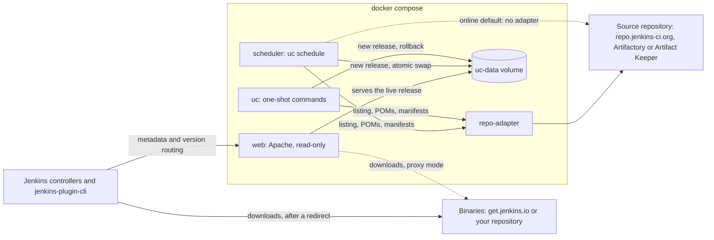

# Jenkins update center, self-hosted

The same update center Jenkins uses (`updates.jenkins.io`), in containers on your own host. Jenkins
controllers and `jenkins-plugin-cli` point at it with no plugin or code change. It runs online,
reading the public plugin repository, or fully air-gapped, reading your own.

## What you get

- **Version routing:** `/update-center.json?version=2.528.1` redirects each controller to the tiered
  site that only offers plugins its core can run, exactly as updates.jenkins.io does.
- **Every upstream file:** `update-center.json`, `plugin-versions.json`, `release-history.json`,
  the experimental and stable sites, download index pages, and tool installers.
- **Your own signing keys:** metadata is signed with your PKI; controllers trust your root CA.
- **Safe publishing:** each release is validated before it goes live, the switch is atomic, the last
  five releases are kept, and `uc rollback` goes back in one command.
- **Online or air-gapped:** plugins from repo.jenkins-ci.org, or from your Artifactory or Artifact
  Keeper, with missing POMs, descriptions and release dates filled in from the plugins themselves.
- **Your own policy:** hide plugins or releases, and publish your own security warnings.
- **Monitoring:** `status.json` reports the last run, the certificate's expiry and the age of the
  security data.

## How it works

A scheduler regenerates the site with Jenkins' own generator, update-center2, and an Apache
container serves it. Plugin binaries are not copied: downloads go to get.jenkins.io or to your
repository. More in the [architecture overview](docs/architecture/overview.md).



## Quick start

You need a Linux host with Docker (Compose v2), GNU make and git, a hostname for the update center,
and a Jenkins community account (online) or an account on your repository (air-gapped). Details:
[Requirements](docs/getting-started/requirements.md).

### Online

```bash
git clone https://gitlab.com/ZacharySHale95/jenkins-update-center.git
cd jenkins-update-center
make build
cp .env.online.example .env          # set PUBLIC_URL to your update center's origin
make secrets-placeholders
printf '%s' 'community-user' > secrets/repo_username        # free: https://accounts.jenkins.io
printf '%s' 'community-password' > secrets/repo_password
make pki-init                        # signing keys; move secrets/root/ offline afterwards
docker compose up -d
```

Write the credentials before `make pki-init`: on Linux it gives `secrets/` to the containers' user,
and later changes need `sudo` ([File ownership on Linux](docs/reference/secrets.md#file-ownership-on-linux)).

The first run reads the whole plugin catalog and **takes hours**; follow it with
`docker compose logs -f scheduler`. When `docker compose run --rm uc status` shows a `live_release`,
point Jenkins at it: [Configure Jenkins controllers](docs/how-to/configure-jenkins.md).

Full walkthrough: [Deploy online](docs/getting-started/online.md).

### Air-gapped

```bash
git clone https://gitlab.com/ZacharySHale95/jenkins-update-center.git
cd jenkins-update-center
make build                            # needs internet once; see below for hosts without it
cp .env.airgapped.example .env        # set PUBLIC_URL, REPO_URL, REPO_KEY; uncomment COMPOSE_FILE
make secrets-placeholders
printf '%s' 'svc-jenkins-uc' > secrets/repo_username
printf '%s' 'password-or-token' > secrets/repo_password
make pki-init                         # signing keys; move secrets/root/ offline afterwards
docker compose run --rm uc doctor --fetch       # what the generator will see in your repository
docker compose up -d
```

Your repository holds the plugins and cores to offer, in Maven layout:
[Stock an air-gapped repository](docs/how-to/stock-airgapped-repository.md). No internet on the
Docker host? Build on a connected machine and carry the images and a `git bundle` of this repository
across, then use `make -o build-uc pki-init`:
[Build the images](docs/getting-started/airgapped.md#2-build-the-images). As online, write the
credentials before `make pki-init`. When a release is live,
[configure Jenkins controllers](docs/how-to/configure-jenkins.md).

Full walkthrough: [Deploy air-gapped](docs/getting-started/airgapped.md).

## After the quick start

1. **Move `secrets/root/` offline.** It holds the root CA's key; anyone with it can sign metadata
   your controllers accept. [Where the root key lives](docs/how-to/rotate-signing-certificate.md#where-the-root-key-lives).
2. **Trust `secrets/root-ca.crt` on every controller**, in `$JENKINS_HOME/update-center-rootCAs/`.
   [Trust the root CA](docs/how-to/configure-jenkins.md#trust-the-root-ca).
3. **Put TLS in front.** [Enable TLS](docs/how-to/enable-tls.md).

Then set up [monitoring](docs/how-to/monitor.md) and a reminder to
[rotate the signing certificate](docs/how-to/rotate-signing-certificate.md) yearly.

## Documentation

The [documentation index](docs/README.md) has everything:

- **Getting started:** requirements, and a production deployment per mode.
- **How-to guides:** configuring controllers, stocking a repository, TLS, proxied downloads, key
  rotation, blocking plugins, rollback, monitoring, upgrades.
- **Reference:** every setting, `uc` command, secret, `status.json` field, URL, network host and
  dependency.
- **Architecture:** how the pieces fit, with diagrams.

Something wrong? See [Troubleshooting](docs/troubleshooting.md).

## Contributing

Contributions are welcome: see [CONTRIBUTING.md](CONTRIBUTING.md). Please report security issues
privately, as described in [SECURITY.md](SECURITY.md).

## License

MIT, see [LICENSE](LICENSE). The update-center2 generator this project builds and patches is
published by the Jenkins project without a repository-wide license file; see
[Dependencies](docs/reference/dependencies.md#note-on-update-center2s-license).
