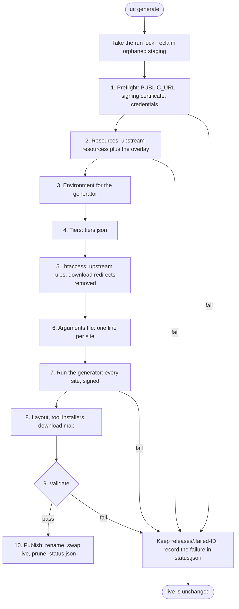

# Generation pipeline

What uc generate does, step by step, and what happens when a step fails.

## Overview

Every run builds a new release in a staging directory next to the published ones. It becomes live
only if every step, validation included, succeeds; a failed run leaves the site Jenkins sees
untouched. The scheduler runs it on `GENERATE_SCHEDULE`, and you can run it by hand with
`docker compose run --rm uc generate`.

Before step 1, the run takes an exclusive lock on `/data/.lock`; a second `uc generate` or
`uc rollback` exits with code 75 instead of waiting. It then removes staging and work directories
left behind by a run that was killed, and records that as a warning.

## Step 1: Preflight

- `PUBLIC_URL` must be an `http` or `https` origin with a host and nothing else: no path, query,
  fragment or credentials. `localhost` and loopback addresses are refused unless
  `ALLOW_LOCAL_PUBLIC_URL=true`. Plain `http` is allowed with a warning: signatures protect the
  metadata's integrity, but TLS is still recommended.
- The signing key and certificate must exist, match each other, be issued by `root-ca.crt`, and stay
  valid for at least `CERTIFICATE_MINIMUM_VALID_DAYS` (30) more days. An expiring certificate stops
  publication before Jenkins would reject the signature.
- Credentials: with the repo-adapter on, the token the adapter created in
  `/data/repo-adapter/token`; with it off, `repo_username` and `repo_password`. GitHub credentials
  are optional; without them the run uses a placeholder and warns that labels from GitHub topics
  will be missing.

## Step 2: Resources

Upstream keeps security warnings, plugin suspensions and label definitions as data in
update-center2's `resources/` directory, not in the generator. The run obtains a copy according to
`RESOURCES_SOURCE`:

- `github`: resolve `RESOURCES_REF` (default `master`) to a commit, then download that commit's
  tarball;
- `url`: download the tarball at `RESOURCES_URL`, and check `RESOURCES_SHA256` when set;
- `bundled`: the copy built into the image, from the pinned update-center2 tag.

If fetching fails, the run uses `/data/resources/last-good/` (the copy behind the last published
release) and warns; with no last good copy, the run fails. Then the
[overlay](../how-to/block-plugins-and-add-warnings.md) in `config/overlay/` is applied. The source,
commit or checksum, and the data's age go into `status.json`.

## Step 3: Environment for the generator

The generator is configured through environment variables, set from the settings:

- `DOWNLOADS_ROOT_URL` = `${PUBLIC_URL}/download`, so every download URL in the signed metadata
  points at this update center;
- the repository: the repo-adapter's address and token when it is on, or `REPO_URL`,
  `REPO_API_URL`, `REPO_KEY` and the repository credentials when it is off;
- the download cache, `/data/cache/<source>`, kept separate for the adapter and for direct reads;
- GitHub credentials, `POPULARITY_JSON_URL`, `CERTIFICATE_MINIMUM_VALID_DAYS`, `CORE_AGE_DAYS`;
- anything in `JAVA_TOOL_OPTIONS`, such as the heap size or the generator's outbound proxy (the
  `uc` code's own downloads use `HTTPS_PROXY` instead).

`REPO_URL` is passed with an explicit port (`:443` or `:80` added when missing), because the
generator's authenticator compares ports when it answers a challenge. Downloads still use the URL
as configured.

## Step 4: Tiers

The generator is run once to write `tiers.json`: the weekly and LTS core versions that get a tiered
site ([Core age](modes.md#core-age) says which). Either list may be empty; a repository with no
`jenkins-war` produces no tiers at all.

## Step 5: .htaccess

The release's root `.htaccess` holds upstream's version routing:

- both tier lists non-empty: upstream's `generate-htaccess.sh` output, unchanged;
- one list empty: upstream's output with the targets it leaves dangling pointed at `current/`;
- both empty: a static template with upstream's rules that do not depend on tiers.

Upstream's five download redirects (to get.jenkins.io) are then removed, because the web
container handles downloads itself. Each must be found exactly once, or the run fails: that is how
a changed upstream script gets noticed. See [Request routing](request-routing.md).

## Step 6: Arguments file

One line per site, as upstream's own `site/generate.sh` writes them. Every line carries the signing
key, certificate and root CA, the connection-check URL `${PUBLIC_URL}/uctest.json` and the site id
`UC_ID`:

- one per weekly tier, into `dynamic-<version>/`, limited to plugins that core can run;
- one per LTS tier, into `dynamic-stable-<version>/`, stable releases only;
- `experimental/`, including alpha and beta releases;
- `current/`, which also writes the release history, plugin versions, documentation URLs, the
  latest-core and plugin-count files, the `download/` index pages and `latest/` links.

`UC_EXTRA_ARGS` is appended to every line. The generator is never asked to download binaries.

## Step 7: Run the generator

update-center2 runs once over the arguments file, reading the merged resources. It lists the
repository, fetches each release's manifest, POM and description (cached for later runs), and
writes and signs every site, checking each signature it produces. Its output goes to the container
log.

## Step 8: Layout and download map

- Links upstream's publishing script creates: `updates/` in every site, `stable` to the newest LTS
  tier (or `current`), and top-level links to `current/`'s files.
- `uctest.json`, `tiers.json` and an `index.html`.
- `updates/`: when `TOOL_INSTALLERS_URL` is set, every tool-installer file its listing names,
  unmodified (they carry the Jenkins project's own signatures). If that fails, the previous
  release's copy is kept, with a warning.
- The download map, `.htdownload-map`: with `DOWNLOAD_BACKEND=artifactory`, the run lists the
  repository again and maps each `plugins/<id>/<version>` and `war/<version>` to its Maven path;
  the web container looks each download up in it. Empty for the `mirror` backend.

## Step 9: Validate

Every check runs, and every failure is listed in the error:

- every signature block names the configured signing certificate;
- every site has its required files, and its JSON parses; `current/` has `latestCore.txt` when the
  site offers a core;
- every download URL in the metadata starts with `${PUBLIC_URL}/download/`;
- `.htaccess` redirects to no absolute URL;
- the release has plugins, and at least `MIN_PLUGIN_RATIO` of the live
  release's count (`uc generate --force` skips this ratio check once, for a deliberate shrink);
- with the `artifactory` backend, the download map has an entry for every plugin version and core
  any site offers.

A repository with no `jenkins-war` publishes a plugins-only site: no core, no tiers. That is valid;
`uc doctor` warns about it.

With the `artifactory` backend the run also computes the [uc doctor](../reference/cli.md#uc-doctor)
counts for `status.json`, and warns when anything in the repository was dropped.

## Step 10: Publish

1. The staging directory is renamed to `releases/<id>`.
2. A new `live` symlink is created beside the old one and renamed over it, so the switch is atomic.
3. This run's upstream resources become the new `resources/last-good/`.
4. All but the newest `RETAIN_RELEASES` releases are deleted, never the live one.
5. `status.json` is rewritten with the new release, its certificate, tiers, counts and warnings.

The web container serves the new release from its next request; nothing restarts.

## Failed runs

- `uc generate` exits non-zero and prints the full error; the scheduler's log has it for scheduled
  runs.
- The failed staging directory is kept as `releases/.failed-<id>` for inspection, replacing any
  older one.
- `status.json` records `last_run` with `result: failed` and only the error's class; the rest of the
  document still describes the live release.
- `live` is unchanged, so Jenkins keeps getting the previous release.
- A run killed part-way (a container stop, a crash) leaves staging behind; the next run removes it.

What each error means and how to fix it: [Troubleshooting](../troubleshooting.md#generation).
