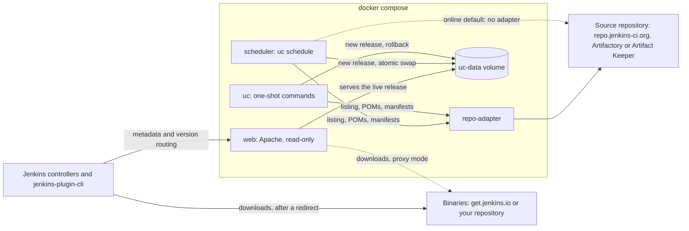

# Architecture overview

How the containers, the data volume and the networks fit together, for operators and contributors.

## Components

Everything runs with Docker Compose from two images: the **uc image** (the update-center2 generator
on a Java runtime, plus the `uc` command in Python) and the **web image** (Apache).

- **web** serves the live release to Jenkins controllers: the signed metadata, upstream's
  `?version=` routing to tiered sites, and `/download/` routes that redirect (or proxy) to where the
  binaries are. It mounts the data volume read-only and never sees the signing key. See
  [Request routing](request-routing.md).
- **scheduler** runs `uc generate` on `GENERATE_SCHEDULE`, and at once when no release is live.
  Each run builds a complete new release, validates it, and swaps it in atomically. See
  [Generation pipeline](generation-pipeline.md).
- **uc** is the same image for one-shot commands: `generate`, `doctor`, `rollback`, `status`. It
  runs only when you call it. See [uc command reference](../reference/cli.md).
- **repo-adapter** answers the generator's repository requests from Artifactory or Artifact Keeper,
  and fills in POMs, descriptions and release dates from inside each plugin archive. On by default
  in air-gapped mode, idle otherwise. See [repo-adapter](repo-adapter.md).

The update center serves metadata only. Plugin and core binaries stay where they already are:
get.jenkins.io online, your repository air-gapped.

## Data volume

All state lives on one Compose volume, `uc-data`, mounted at `/data`:

| Path | Contents |
|---|---|
| `releases/<id>/` | One complete site per release. Ids are UTC timestamps, `YYYYMMDDTHHMMSSZ`. The newest `RETAIN_RELEASES` are kept. |
| `live` | A symlink to the release being served. Publishing and rollback replace it atomically. |
| `releases/.failed-<id>/` | The last failed attempt, kept for debugging. |
| `cache/` | The generator's download cache (manifests, POMs), one directory per source, so later runs fetch only what is new. |
| `resources/last-good/` | The last upstream `resources/` copy that produced a published release, used when a fetch fails. |
| `repo-adapter/` | The repo-adapter's access token, its content-addressed cache and `report.json`. |
| `status.json` | The public [status](../reference/status-json.md), served at `/status.json`. |
| `.lock` | The run lock: one `uc generate` or `uc rollback` at a time. |

Everything is on one filesystem so that publishing is a rename, never a copy: the web container
sees either the old release or the new one, never a half-written one.

## Networks and trust boundaries

The Compose networks are listed in [Compose networks](../reference/network.md#compose-networks).
The boundaries they and the images draw:

- The signing key reaches only the `scheduler` and `uc` containers. The internet-facing `web`
  container never has it, and the root CA key is meant to live offline.
- Every container runs as a non-root user (uid 10001 for the uc image, 33 for web) with a read-only
  root filesystem; only `/data` and `/tmp` are writable, and `web` mounts `/data` read-only.
- The repo-adapter's file reads need no credentials, because the generator cannot answer an
  authentication challenge on them. They are reachable only on the internal `repo` network, which
  `web` is not attached to, and they serve only POMs, manifests and descriptions, never archives.
  The listing needs a token from `/data/repo-adapter/token`, which only uid 10001 can read.
- Air-gapped, only the repo-adapter receives the repository credentials.
- Archives and POMs from the repository are treated as untrusted input: reads are size-capped,
  only named entries are read, and XML with DOCTYPE or entity declarations is refused.
- `status.json` is public, so it carries counts and error class names only, never paths, URLs or
  messages from the repository.

## Not in scope

- Hosting or copying plugin binaries: they stay where they are, as with updates.jenkins.io.
- Kubernetes packaging (a Helm chart).
- Exporting a site from one network and importing it into another.
- A tool to procure plugins together with their POMs.
- An internal-only plugin site for plugins that are not on the public update center.
- Caching proxies or high availability; one stack serves one update center.
