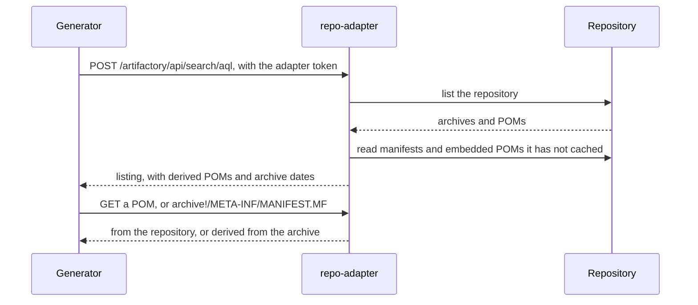

# repo-adapter

How the repo-adapter serves Artifactory and Artifact Keeper to the generator and fills in what a repository lacks.

## Why it exists

update-center2 was written for repo.jenkins-ci.org, and it expects things a procured repository
rarely provides:

- it only speaks Artifactory's API, so it cannot read Artifact Keeper at all;
- it ignores any plugin or core without a `.pom` beside it, and files procured from
  updates.jenkins.io come without one;
- it reads the repository's timestamps as release dates, which in your repository are upload dates;
- it cannot authenticate its file reads, only its listing, so a repository that needs credentials
  for every read breaks it.

The repo-adapter sits between the generator and the repository. It answers the generator's
Artifactory requests from either repository type, and fills the gaps from inside each plugin
archive, which already contains its POM, its description and a build date. The generator itself is
unmodified. `uc doctor` and the download map read the repository through it too.

It is on by default in air-gapped mode, off online (repo.jenkins-ci.org has none of these gaps), and
always on for `REPO_TYPE=artifact-keeper`. It runs as its own service from the uc image,
`uc repo-adapter`, listening on port 8081 of the internal `repo` network. Downloads never pass
through it: controllers still get binaries from the repository through the web container.

## Requests it answers

The adapter speaks Artifactory's dialect under `http://repo-adapter:8081/artifactory/`:

| Request | `REPO_TYPE=artifactory` | `REPO_TYPE=artifact-keeper` |
|---|---|---|
| `POST /artifactory/api/search/aql` (the listing; needs the token) | forwarded to `REPO_API_URL`, then gap-filled | built by paging through Artifact Keeper's artifact list, then gap-filled |
| `GET /artifactory/<REPO_KEY>/<path>.pom` | forwarded, or a POM derived from the archive | read from `/maven/<REPO_KEY>/<path>`, or derived |
| `GET /artifactory/<REPO_KEY>/<archive>!/<entry>` (an entry inside an archive) | forwarded (Artifactory extracts it), or served from the cache | served from the cache |
| `GET /healthz` | 200 | 200 |

Anything else returns 404, including whole archives. The listing endpoint accepts only the exact
query the generator and `uc` send, for `REPO_KEY`; any other query gets 400. A repository error
returns 502, which fails the generation cleanly.

Each listing leaves an index in memory that later reads are answered from. A read that arrives
before any listing, as after an adapter restart, builds one first.

## Filling gaps

The repository's own file always wins over a derived one. Everything is decided while the listing
is built, so the listing never names a file the adapter cannot serve.

1. **Coordinates.** Each `.hpi` or `.jpi` is identified by its manifest's `Group-Id`, `Artifact-Id`
   and `Plugin-Version`. A `.war`, or an archive whose manifest lacks one of them, uses its path.
2. **Misplaced archives.** When the manifest's coordinates disagree with the path, the archive is
   left out and reported with the path it belongs at. Publishing it would advertise the wrong
   coordinates; the fix is to move the file.
3. **Usable POMs.** A `.pom` counts only if it is well-formed XML (DOCTYPE and entity declarations
   are refused), has a `<project>` root, and names the same group (its own or its parent's),
   artifact and version as its path. Anything else, such as a saved HTML error page, is ignored and
   reported.
4. **Derived POMs.** An archive without a usable `.pom` gets the POM embedded in it
   (`META-INF/maven/<group>/<artifact>/pom.xml`), if that one is usable. The listing gains a `.pom`
   entry beside the archive.
5. **No POM at all.** Plugins built without Maven (Gradle) embed none. Nothing is added, the
   generator drops the plugin, and `uc doctor` lists it with the repo.jenkins-ci.org URL of the real
   `.pom` to procure.
6. **Descriptions.** A plugin's description is the `index.jelly` inside its `.jar`. When the
   repository has no separate `.jar`, the adapter reads it from the `.hpi`: from
   `WEB-INF/lib/<artifactId>.jar`, then `WEB-INF/lib/<artifactId>-<version>.jar`, then
   `WEB-INF/classes/index.jelly`. Without one, the generator falls back to the POM's description.
7. **Archive entries served:** `META-INF/MANIFEST.MF` of any archive, and `index.jelly` of a plugin
   `.jar`. Any other entry returns 404.
8. **Parent POMs** are forwarded when the repository has them, and return 404 otherwise; they
   cannot be derived. Without them some plugins lose their SCM link.

## Release dates

In your repository the listing's timestamps are upload times, but the generator reads them as
release dates: they drive "recent releases", the release history and which cores are old enough
for [Core age](modes.md#core-age). The adapter replaces them with each archive's own date: the time
of its `META-INF/MANIFEST.MF` entry in the zip directory (the UTC extended timestamp when present,
otherwise the DOS time read as UTC).

The archive date is used only if it is on or after 2004-01-01 and no more than one day after the
repository's time (the day covers the missing time zone; a build cannot follow its upload), so dates
are accurate to about a day. Otherwise, or when it cannot be read (such as the 1980-02-01
placeholder some builds write), the repository's time is kept and the archive is reported under
"dates from the repository". The date applies to the archive and its `.pom`, for plugins and cores
alike. With the adapter off, dates are whatever the repository reports: upload times for your own
repository.

From Artifactory the date is read with HTTP range requests for the zip directory; a server that
ignores ranges falls back to the repository's time rather than downloading whole archives. From
Artifact Keeper it is read from the archive the adapter downloads anyway.

## Cache

- Everything derived from an archive is cached under `/data/repo-adapter/cache/`, addressed by the
  archive's SHA-256: its manifest, coordinates, embedded POM, description and date, or markers
  saying each is absent. Content addressed by checksum never changes, so entries never go stale.
- Writes go to a temporary file and are renamed into place, so concurrent requests are safe.
- From Artifact Keeper, which has no range or archive-entry support, each archive is downloaded
  once over the life of the cache, to a temporary file that is deleted after its entries are read.
- Entries not used for 30 days are removed at the end of a listing.

## Limits

Archives are untrusted input.

| Limit | Value |
|---|---|
| Archive download | `REPO_MAX_ARCHIVE_MB` (512 MB); a larger archive is skipped and reported |
| A POM, manifest or `index.jelly` | 1 MiB |
| An inner `.jar` | 64 MiB |
| The zip directory read for dates | 16 MiB; larger falls back to the repository's time |
| The listing response | 256 MiB |
| Backend request timeout | 60 s; 600 s for archive downloads and the listing |
| Requests handled at once | 32; more get 503 |
| An idle connection | closed after 120 s |
| A listing request's `Content-Length` | at most 64 KiB (413); not a number, or negative: 400 |

Reads stop at the limit plus one byte whatever the archive claims, only named entries are read, and
nothing is ever extracted to a path taken from an archive. Every fetched file must return HTTP 200
and pass its own check, so an error page is never cached as content.

## Security

- **Credentials.** The adapter reads `repo_username` and `repo_password`. For Artifact Keeper the
  password is an API token, sent as a bearer token to its API and as basic authentication to its
  Maven endpoint. Air-gapped, no other container receives them.
- **The token.** On first start the adapter writes a random 32-byte token to
  `/data/repo-adapter/token` (mode 0600). `uc` passes it to the generator as the repository
  password, and the listing is refused without it (HTTP 401). Only services on the internal `repo`
  network can reach the listing; the web container is not on it.
- **File reads need no token**, because the generator cannot answer a challenge on them. They serve
  only POMs, manifests and descriptions, never archives, and only on the internal `repo` network,
  which the web container is not on.
- **Redirects** from the repository to another host (object storage), or from HTTPS to HTTP, are
  followed without the `Authorization` header.
- **TLS** to the repository is verified against the system CA bundle plus `REPO_CA_FILE` when set.
- **Logging** never includes credentials; URLs are logged without user information.
- **Trust is unchanged.** Every derived file comes from inside an archive you put in the
  repository, and signing still happens afterwards with your key.

## Report

After each listing the adapter writes `/data/repo-adapter/report.json` (mode 0600): what it derived,
replaced, dropped and dated from the repository, with paths and URLs.

- `uc doctor` reads it and adds sections for POMs filled in from archives, plugins that need a real
  `.pom`, `.pom` files ignored (all three with the repo.jenkins-ci.org URL of the real `.pom`),
  misplaced archives (with the correct paths), skipped archives, and dates taken from the
  repository. See [uc doctor](../reference/cli.md#uc-doctor).
- `status.json` is public, so it gets counts only, under `doctor.repo_adapter`, and one warning
  line when anything was dropped.
- With the adapter off there is no report.
