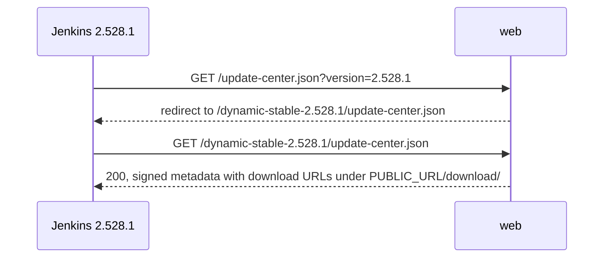
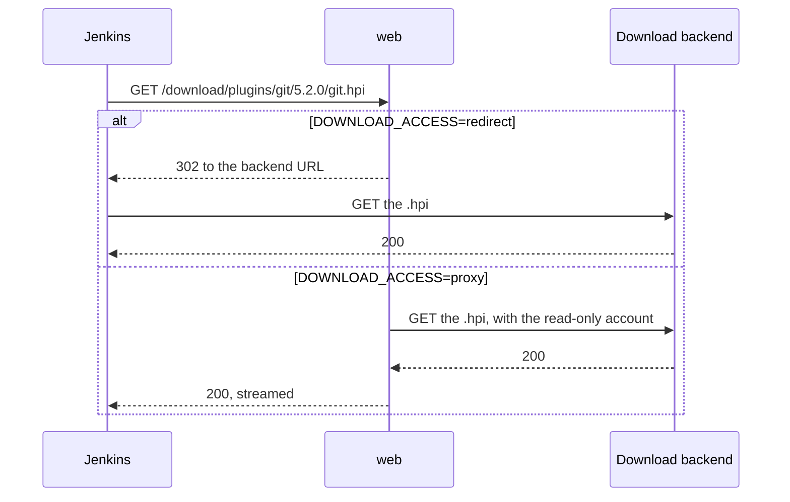

# Request routing

How the web container answers Jenkins: version routing to tiered sites, downloads, headers and the live swap.

## How updates.jenkins.io works

This project reproduces the public update center, so its behavior follows upstream's:

- **The update center serves metadata only.** Binaries are downloaded from the `url` each plugin
  and core has in the signed metadata. Upstream generates those URLs from `DOWNLOADS_ROOT_URL`;
  here it is `${PUBLIC_URL}/download`, and the web container sends each download on to the real
  location.
- **Tiers.** A controller must only be offered plugin versions it can run. The generator writes one
  site per core version that plugins require (`dynamic-<weekly>/`, `dynamic-stable-<lts>/`), each
  offering the newest plugin versions that core supports, and `current/` for the newest core.
- **Version routing.** Jenkins requests `/update-center.json?version=<its version>`, and upstream's
  `.htaccess` rules redirect that to the right tier. This project uses those rules unchanged,
  generated by upstream's own script.
- **`jenkins-plugin-cli`** reads `JENKINS_UC`, `JENKINS_UC_EXPERIMENTAL` and `JENKINS_PLUGIN_INFO`,
  and builds download URLs from the host of `JENKINS_UC`, ignoring any path. Upstream's rules also
  redirect to absolute paths such as `/current/...`. That is why `PUBLIC_URL` must be a bare origin
  on its own hostname.

## Version routing

The release's root `.htaccess` (see [Step 5](generation-pipeline.md#step-5-htaccess)) matches the
`version` query parameter and redirects to the newest tier at or below it, of the same kind:
weekly tiers for `2.x`, LTS tiers for `2.x.y`. Without a version it redirects to `current/`.
Examples: [Version routing](../reference/site-layout.md#version-routing).

Apache runs with `ServerName ${PUBLIC_URL}` and `UseCanonicalName On`, so redirects name the public
scheme, host and port even behind a reverse proxy or on a remapped port.

## Downloads

Download routes are handled at server level (`web/conf/uc-site.conf`), before the release's
`.htaccess`, and depend on two settings:

- **`DOWNLOAD_BACKEND=mirror`** (online default): paths map onto get.jenkins.io's layout.
  `/download/plugins/<id>/<version>/<id>.hpi` goes to `plugins/<id>/<version>/<id>.hpi`; a core
  version with three components (an LTS) goes to `war-stable/<version>/jenkins.war`, any other to
  `war/<version>/jenkins.war`.
- **`DOWNLOAD_BACKEND=artifactory`** (air-gapped default): each request is looked up in the
  release's download map, `.htdownload-map`, which `uc generate` writes from the repository listing.
  The key is `plugins/<id>/<version>` or `war/<version>`, the value the Maven path. A version not in
  the map returns 404.

`/download/plugins/<id>/latest/<id>.hpi` and `/download/war/latest/jenkins.war` first redirect to
`/latest/`, whose generated rules redirect to the versioned URL. Anything else under `/download/`
that looks like a binary returns 404; the index pages are static files in the release. Under
`/download/`, methods other than GET and HEAD get 405, and the client's query string is dropped.

With `DOWNLOAD_ACCESS=proxy`, Apache sends the credentials from `download_proxy_auth`, verifies the
backend's certificate against `DOWNLOAD_PROXY_CA_FILE`, and times out after 300 seconds. Nothing is
cached. See [Proxy plugin downloads](../how-to/proxy-downloads.md).

## Headers

| Path | Header |
|---|---|
| `*.json`, `*.txt` | `Cache-Control: public, max-age=300` |
| `/download/**/*.hpi`, `/download/**/*.war` | `Cache-Control: public, max-age=3600` |
| `/status.json` | `Cache-Control: no-store` |

JSON, JavaScript, text, HTML and CSS are compressed. `ServerTokens Prod` and `ServerSignature Off`
hide the Apache version, `TRACE` is disabled, and `.ht*` files are never served. Access logs go to
the container's standard output in combined format; Jenkins' user agent includes its version.

## Live swap

The document root is `/data/live`, a symlink to the current release. Publishing and rollback
replace that symlink atomically, and Apache follows the new target from the next request. The
download map is read through the same link, and Apache reloads a text map when its file changes, so
routing and downloads switch together, with no restart. The routing tests prove this
(`tests/routing/test_live_swap.py`).

Apache will not start without its document root and the download map file, so on first start the
web container's entrypoint waits for the first published release, logging "waiting for the first
published release" once a minute until then.

## Where web gets its settings

The web container gets only its own variables, which Compose takes from `.env` (`compose.yaml`
lists them under `web`'s `environment:`): `PUBLIC_URL`, `MODE`, `DOWNLOAD_BACKEND`,
`DOWNLOAD_BACKEND_URL`, `DOWNLOAD_ACCESS`, `DOWNLOAD_PROXY_CA_FILE`, `TLS_CERT_FILE` and
`TLS_KEY_FILE`. Nothing else in `.env`, proxy credentials included, reaches it.

- With `DOWNLOAD_BACKEND` unset, web uses `artifactory` in air-gapped mode and `mirror` otherwise,
  the same rule as uc. `mirror` sends downloads to get.jenkins.io unless `DOWNLOAD_BACKEND_URL`
  says otherwise; `artifactory` needs `DOWNLOAD_BACKEND_URL`.
- `docker compose run --rm --no-deps uc config --check` checks web's settings too, so run it before
  `docker compose up -d`. When one of them is invalid, web exits with `entrypoint: ...` naming it:
  `docker compose logs web` shows the message.
- A Compose override can set any of them on `web` itself, as `compose.tls.yaml` does
  ([Enable TLS](../how-to/enable-tls.md)).
- Before it waits for the first release, `web` logs one line, `entrypoint: serving <PUBLIC_URL>;
  downloads: <DOWNLOAD_BACKEND> <DOWNLOAD_BACKEND_URL> (<DOWNLOAD_ACCESS>)`, so
  `docker compose logs web` shows what it is serving. It holds no secret: a `DOWNLOAD_BACKEND_URL`
  with credentials in it is refused, by uc and by the entrypoint.
