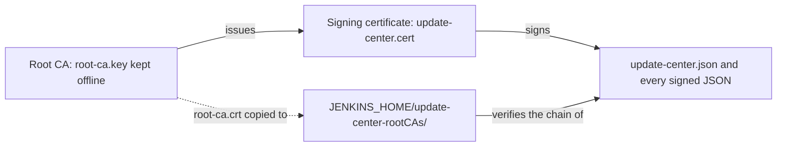

# Signing and trust

How the update center signs its metadata and how Jenkins controllers come to trust it.

## The PKI

Jenkins only accepts update center metadata signed by a certificate that chains to a root it
trusts. The update center uses its own two-level PKI, created by first-time setup,
`docker compose run --rm setup` (or `make setup`), which runs `uc pki init` with openssl:

| File | What it is |
|---|---|
| `secrets/root/root-ca.key` | The root CA's private key: RSA 4096. Needed only to issue signing certificates; move it offline. |
| `secrets/root-ca.crt` | The root CA certificate: 10 years (3650 days), `CA:TRUE, pathlen:0`, key usage `keyCertSign, cRLSign`. Every controller trusts it. |
| `secrets/update-center.key` | The signing key: RSA 4096. Mounted only into `scheduler` and `uc`. |
| `secrets/update-center.cert` | The signing certificate, issued by the root: 365 days by default, key usage `digitalSignature`. |

The subjects name the organization "Easy Update Center" unless `--org` is given.
`uc pki init` refuses to overwrite existing files, and first-time setup runs it only when
`secrets/update-center.key` does not exist.

## Trust chain

The generator signs each site's metadata with the signing key and embeds the signing certificate.
A controller verifies the signature and the certificate's chain to any root certificate in
`$JENKINS_HOME/update-center-rootCAs/`. Copying `root-ca.crt` there is the only trust step; see
[Trust the root CA](../how-to/configure-jenkins.md#trust-the-root-ca).

The tool installer files under `updates/` keep the Jenkins project's own signatures, which Jenkins
trusts already.

## Rotation

- **The signing certificate** expires after a year by default. Issue the next one from the root with
  `uc pki rotate`; controllers need no change, because they trust the root. `status.json` shows the
  days left (`signing_cert.days_left`).
- **The root CA** lasts ten years. Replacing it takes an overlap: add the new root to every
  controller first, then switch signing, then remove the old root.

Both procedures: [Rotate the signing certificate](../how-to/rotate-signing-certificate.md).

## What Jenkins checks

When a controller loads the metadata it checks the signature, the chain up to a root in
`update-center-rootCAs/`, and that every certificate in it is within its validity period. A
controller with a badly wrong clock rejects valid metadata.

To keep an expiring certificate from ever reaching controllers, every `uc generate` refuses to run
when the signing certificate expires within `CERTIFICATE_MINIMUM_VALID_DAYS` (default 30), and the
generator applies the same limit. Publication stops, the live release stays as it was, and
`status.json` and the log say why.
